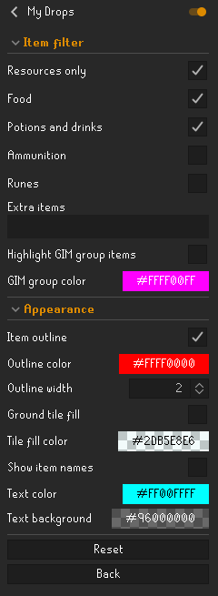

# My Drops

Highlight items you drop with custom colors, outlines, tile fill, and optional item labels.

## How to use

1. Install **My Drops** from RuneLite's Plugin Hub once the submission is approved, then enable it.
2. Leave **Resources only** on and choose food, potions, ammunition, or runes. Add other exact item names under **Extra items**, separated by commas. Turn Resources only off to include all item types.
3. Under **Appearance**, choose your outline, tile fill, text, and background colors. Color pickers also control opacity.
4. Drop an item from your inventory to highlight it.

For group ironmen, enable **Highlight GIM group items** and choose a separate **GIM group color**. This includes group-owned loot and uses the same item filters. No Party setup is needed, and individual droppers are not identified.

Optional names can overlap labels from RuneLite's Ground Items plugin; leave names off here if you prefer its labels. Drop matching is conservative, and reloading a scene clears marks until new item events occur. GIM behavior still needs live verification.

[Development and testing](docs/development.md)
